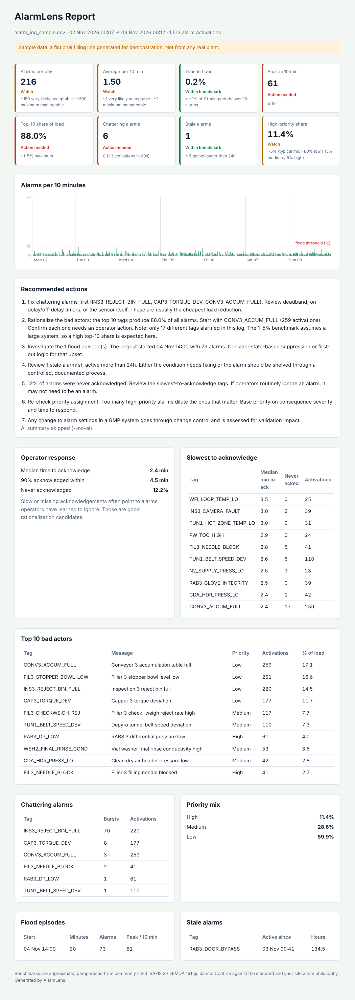
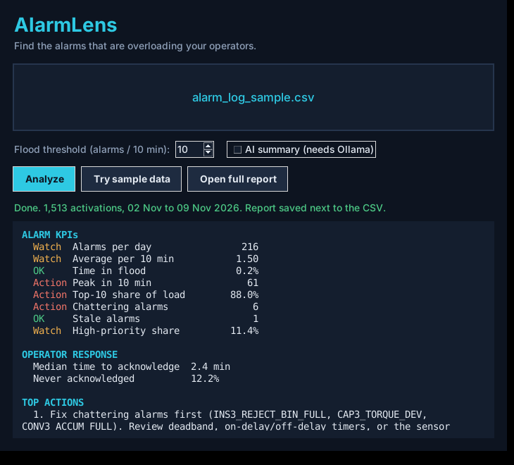

# AlarmLens

**Find the alarms that are overloading your operators.** AlarmLens reads a SCADA alarm-log
export (CSV), measures it against ISA-18.2 / EEMUA 191 style alarm-management benchmarks,
and produces a one-page HTML report with the bad actors, chattering alarms, flood episodes,
stale alarms, priority mix and operator response times. It also gives prioritized recommendations, and an optional
summary written by a free local AI model.



## Why
Alarm floods and nuisance alarms bury the alarms that matter. In GMP aseptic manufacturing
that means slower operator response and more deviations. Alarm rationalization starts with
measuring the problem. This tool does that measurement in seconds.

## Quick start (Windows)
1. Install Python 3 from python.org.
2. Double-click **Run-AlarmLens.bat**. The first run sets everything up, then the AlarmLens window opens.
3. Drop an alarm-log CSV onto the window (or click to choose one) and click **Analyze**.
   Click **Try sample data** to see it work straight away.



Drag-and-drop uses the small `tkinterdnd2` add-on. If it can't be installed, the window still works with the Choose button.

Command line:
```
python -m alarmlens my_alarm_log.csv --open
python -m alarmlens log.csv --col-time "Raise Time" --col-tag "Source" --priority-map "1=High,2=Medium,3=Low"
```

## Input
One row per alarm event, with columns for time, tag, state, and optionally message and priority.
Common column names are detected automatically, and you can override any of them with `--col-*`.
State words such as `Came In / Raised / Active`, `Went Out / Cleared`, and `Acknowledged` are understood.
Export formats differ between SCADA products and versions, so check your export's column names.

## What it measures
| KPI | Benchmark used (approximate) |
|---|---|
| Alarms per day | ~150 very likely acceptable, ~300 maximum manageable |
| Average per 10 min | ~1 very likely acceptable, ~2 maximum manageable |
| Time in flood | < ~1% of 10-min periods with more than 10 alarms |
| Top-10 share of load | ~1–5% maximum (assumes a large system) |
| Chattering | 0 tags with ≥3 activations in 60 s |
| Stale alarms | < 5 active longer than 24 h |
| Priority mix | ~80% low / 15% medium / 5% high |

These targets are paraphrased from commonly cited ISA-18.2 / EEMUA 191 guidance. Confirm them
against the standards themselves and your site's alarm philosophy. Benchmarks are per operator
position, so analyze one console's alarms at a time.

**Operator response** (when the log has acknowledgement events): median and 90th-percentile time
to acknowledge, the share of alarms never acknowledged, and the tags slowest to be acknowledged.
Alarms that operators routinely ignore are strong rationalization candidates. No benchmark is applied
here; compare against your own site targets.

## AI summary (optional, free, offline)
If [Ollama](https://ollama.com) is running with `llama3.2`, AlarmLens asks it for a short
summary and actions. The model runs on your PC, so no alarm data leaves the machine.
Use `--no-ai` to skip it. Treat AI text as a draft for an engineer to review.

## Data confidentiality
The sample log is **fictional**, generated by `sample/make_sample.py`. Never commit real plant
alarm logs to a public repository; they are usually confidential. `data/` is git-ignored for
that purpose.

## Tests
```
pip install pytest
python -m pytest
```

Built by Chekri Gadhiraju (GMP pharmaceutical automation) · https://gchekri04-droid.github.io
